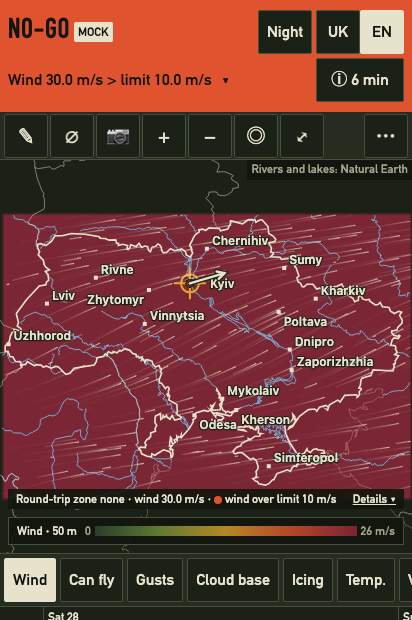
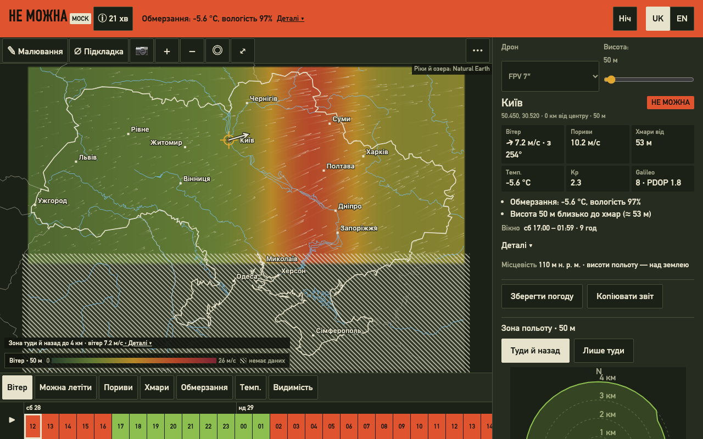
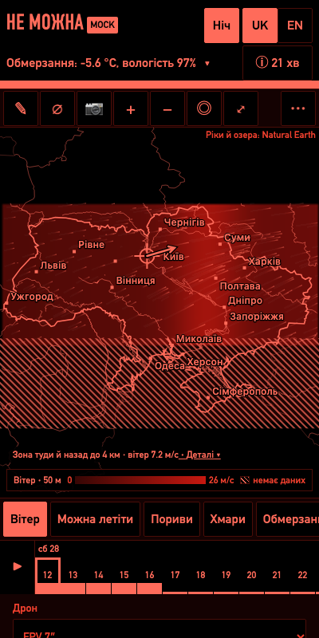

# AMBER Sky

A dual-use weather map for Ukraine combining wind by altitude, weather assessments for drone profiles, Copernicus data and Galileo satellite geometry.

This is a demonstration model, not an official weather forecast. GO means **conditions within the selected profile**, not a guarantee of safety. Unsourced drone limits and simplified calculations are labelled `assumption`; missing data is not GO. The scope is weather only: no targeting, strike planning or drone tracking.

**Live site:** [xand0dev.github.io/amber404-sky](https://xand0dev.github.io/amber404-sky/)

Built by team AMBER//404 for the 12th CASSINI Hackathon, challenge 2: “Space-enabled crisis response and civil resilience”.

## Screenshots

Existing repository captures; the **MOCK** badges identify synthetic demonstration data.

| Phone | Desktop | Night mode |
|---|---|---|
|  |  |  |

## Features

- Wind by altitude, animated wind particles and a 48-hour timeline; layers for gusts, cloud base, icing, temperature and visibility.
- GO / CAUTION / NO-GO assessments with reasons for the selected drone profile, plus source status, forecast age and explicit missing-data indicators.
- Phone and desktop layouts, Ukrainian and English UI, a red-on-black night mode and an installable PWA with cached weather data.
- Terrain relief, rivers and lakes, local map imports and a sharper **offline satellite** basemap: four static image pieces, identical for everyone, cached after loading.
- Optional online **OpenStreetMap streets** and **Sentinel-2 satellite 10 m** imagery from EOX. The menu warns that the **map provider can see the viewed area**; the online choice is **not saved** across reloads. See Privacy & OPSEC below.
- **My location** (the Ukrainian “Де я” button): device geolocation to centre the map, with an optional live position marker. GPS coordinates stay on the device in page memory.
- Map zoom down to approximately **0.8 km across the screen**. This is the map view width, not weather resolution; the forecast grid remains 0.5°.
- Save weather snapshots, copy a weather report, export a map PNG and draw local annotations.

## EU space data

| Dataset | Role in AMBER Sky |
|---|---|
| **Galileo** | CelesTrak orbital elements support hourly visible-satellite counts and Galileo-only PDOP estimates. These describe satellite geometry, not measured positioning accuracy or local interference. |
| **Copernicus ERA5** | Historical weather supplies monthly statistics of hours within the profile rules, separate from the current forecast. |
| **Copernicus DEM GLO-90** | Terrain elevation and shaded relief, accessed through Open-Meteo Elevation. |
| **Sentinel-2** | EOX Sentinel-2 cloudless imagery supplies the static satellite basemap and optional online 10 m layer. The imagery is a 2020 mosaic, not a live satellite feed. |

The [product SPEC, sections 7–8](docs/SPEC.md) describes these uses; [docs/SOURCES.md](docs/SOURCES.md) records provenance and data licences.

## Privacy & OPSEC

The app serves static weather files shared by all users. User points, routes, drawings and imported maps are handled in the browser rather than uploaded to an application backend. Saved user content uses browser storage; the My location marker uses page memory. The app does not send GPS coordinates to a server or write them to logs, URLs or localStorage.

Online basemaps are an explicit exception to the static-file model: selecting Streets or Satellite 10 m sends tile requests to OpenStreetMap or EOX, revealing the viewed area to that provider. The menu displays this warning, and reloading returns to an offline basemap. Static satellite images and relief are the same files for everyone; they work offline once cached. Offline use requires loading the app and the relevant data and images first; forecast updates require a connection, and the UI shows forecast age.

## Run locally

Prerequisites: Git, Make, Python 3.12 or newer, uv, and Node.js with npm. CI uses Node.js 22.

From the repository root:

```bash
make setup   # install Python dependencies with uv and web dependencies with npm ci
make data-mock # generate synthetic weather data marked MOCK
make dev     # generate mock data and start Vite at http://localhost:5173
```

`make check` runs ruff, pytest, ESLint, TypeScript, Vitest, JSON schema validation and the production web build. `make data-mock`, `make check` and `make dev` generate synthetic data marked **MOCK**; no data-service credentials are needed for this local workflow.

`make data` runs the source collectors that are implemented. The current builder falls back to mock files when a collector is unavailable or fails, setting the source status to `nodata` and enabling the MOCK flag. Check the displayed source status and forecast timestamp before interpreting the map.

## Architecture

```text
Data sources (SPEC section 8)
    -> pipeline/ (Python collectors and builder)
    -> web/public/data/ (static JSON validated against contracts/)
    -> web/ (React + TypeScript PWA, Canvas 2D + SVG)
    -> GitHub Pages
```

There is no backend server and no API key in the browser. The web app reads static JSON through `web/src/contracts/`. Calculations live in `web/src/core/` as pure TypeScript without DOM dependencies. Canvas renders weather fields and wind particles; SVG renders boundaries and city labels.

The PWA caches the app and the latest data package for offline use. Optional third-party basemap requests are described in Privacy & OPSEC above.

[deploy.yml](.github/workflows/deploy.yml) collects data, validates schemas, builds the site and deploys to Pages on pushes to `main`, manual dispatch and a scheduled refresh. This repository currently combines those steps in that workflow; SPEC describes separate data and deployment workflows.

## Repository structure

```text
CONSTITUTION.md          Product principles and scope
AGENTS.md               Agent workflow and ownership rules
Makefile                Setup, data, checks and development commands
contracts/              JSON schemas shared by pipeline and web
pipeline/sky/           Python builder, mocks and source modules
pipeline/tests/         Pipeline and contract tests
web/src/app/            App shell, data loading and PWA integration
web/src/contracts/      Typed access to static JSON
web/src/core/           Weather and profile calculations
web/src/features/       Map, layers, timeline, panel and route UI
web/public/data/        Generated JSON; static/ holds profiles, borders and cities
web/e2e/                Browser smoke tests
specs/                  Feature specifications F0–F4
docs/                   Product SPEC, sources, agent pipeline and pitch
scripts/                Issue runner
.github/workflows/      CI, automerge and Pages deployment
```

The [product SPEC](docs/SPEC.md) is the source of truth. See the [F0 specification](specs/F0/spec.md), [constitution](CONSTITUTION.md) and [agent rules](AGENTS.md) for contracts, ownership and contribution constraints.

## Data sources and licences

The following records the sources and licence/access descriptions in [docs/SOURCES.md](docs/SOURCES.md) and [SPEC section 8](docs/SPEC.md). It is a source catalogue, not a claim that every collector is implemented or that a displayed value is live.

| Source ID | Provider and use | Recorded licence / access |
|---|---|---|
| `openmeteo` | Open-Meteo Forecast API: weather forecast and wind profile | CC BY 4.0; free API access is non-commercial only. |
| `ecmwf-open` | ECMWF Open Data (IFS): fallback and proposed commercial forecast source | CC BY 4.0 + ECMWF Terms of Use; commercial use with “© ECMWF” attribution, as recorded in SOURCES. This remains a proposed fallback. |
| `era5` | Copernicus ERA5 via CDS API or Open-Meteo Archive (`models=era5`): historical climate statistics | Copernicus licence / CC BY 4.0, depending on access route. CDS requires an account. |
| `celestrak-galileo` | CelesTrak Galileo TLEs: satellite orbits for visibility and PDOP calculations | Open access; SPEC does not identify a redistribution licence. |
| `noaa-kp` | NOAA SWPC planetary K-index forecast: geomagnetic conditions | Open access; SPEC does not identify a redistribution licence. |
| `ne-ukr` | Natural Earth `ne_10m_admin_0_countries_ukr`: boundaries with Crimea as Ukraine | Natural Earth public domain; Ukraine point of view. |
| `ne-water` | Natural Earth rivers and lakes | Public domain. |
| `cop-dem` | Copernicus DEM GLO-90 via Open-Meteo: terrain and relief | Copernicus DEM licence; © DLR e.V. 2010–2014 and © Airbus Defence and Space GmbH 2014–2018, provided under the EU Copernicus programme. Open-Meteo: CC BY 4.0, non-commercial. |
| `s2cloudless` | Static satellite mosaic, sharper static pieces and optional online EOX tiles | CC BY-NC-SA 4.0, non-commercial. Attribution: “Sentinel-2 cloudless by EOX — Copernicus Sentinel data 2020”. |
| OpenStreetMap | Optional online streets | ODbL; “© OpenStreetMap contributors”. Standard tiles are subject to the tile usage policy linked in SOURCES. |
| Roboto Condensed | Bundled UI font | SIL Open Font License 1.1. |

Source provenance belongs in [docs/SOURCES.md](docs/SOURCES.md). Source status and generation time accompany the data; mock data and assumptions must remain visible. Keep any Copernicus CDS credentials in `.env` or GitHub Secrets, never in code or browser assets.

**Code licence:** [MIT](LICENSE), as stated in the repository licence file. [CONSTITUTION.md](CONSTITUTION.md) still names Apache-2.0; that documentation discrepancy needs reconciliation by the project owner. Data and font licences above apply separately, including the non-commercial restrictions recorded in SOURCES.

## Agent conveyor

The [agent pipeline](docs/PIPELINE.md) describes how labelled GitHub issues become changes: a runner selects an unblocked issue, creates an isolated worktree and feature branch, and starts an agent without interactive questions. The agent reads the spec, writes failing tests, implements the change, runs `make check` and commits. The runner pushes and opens the PR.

CI checks the code, browser smoke tests and allowed paths. Eligible green PRs are squash-merged automatically; shared files require owner review. A merged change triggers Pages deployment. Each issue has one branch and one PR, with acceptance evidence, assumptions, contract requests and an AI log entry in the PR body.

## Team

| Feature | Owner | Responsibility |
|---|---|---|
| F0 | Oleksandr (@xand0dev) | Architecture, scaffold, contracts, assessment rules and submission |
| F1 | Maksym (@kingsneverdie17) | Wind profile and operator interviews |
| F2 | Nastia (@Bulka0801) | Galileo, Kp, ERA5 and business model |
| F3 | Ivan (@gonivanko) | Map, layers and timeline |
| F4 | Olia (@oljyaaa) | Point panel, routes and drone profiles |

Nastia and Maksym present the pitch; Ivan is the on-site contact. Roles follow [SPEC section 9](docs/SPEC.md).
