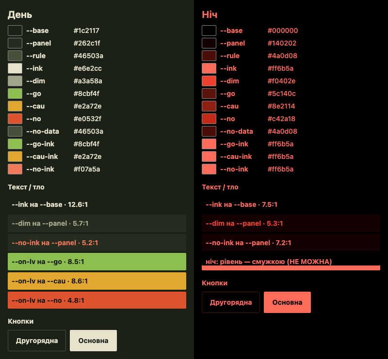

# Візуальна система AMBER//404 Sky (issue #88)

Одне джерело — `web/src/ui/tokens.ts`. Звідти беруться CSS-змінні денної теми (`:root`) і нічної (`:root[data-theme="night"]`); вони вставляються в `<head>` до першого рендеру. У стилях фіч — лише `var(--…)`. Тест `ui/no-hardcode.test.ts` перевіряє, що в CSS немає власних кольорів, розмірів шрифту чи відступів.



## Токени

| Група | Змінні | Значення (день) |
|---|---|---|
| Поверхні | `--base`, `--panel`, `--rule` | `#1c2117`, `#262c1f`, `#46503a` |
| Текст | `--ink` (основний), `--dim` (другорядний) | `#e6e2cc`, `#a3a58a` |
| Вердикти — заливки | `--go`, `--cau`, `--no`, `--no-data`; текст на них `--on-lv` | `#8cbf4f`, `#e2a72e`, `#e0532f`, `#46503a`; `#11150e` |
| Кольоровий текст | `--go-ink`, `--cau-ink`, `--no-ink` | `#8cbf4f`, `#e2a72e`, `#f07a5a` |
| Підписи поверх карти | `--scrim` | `rgba(17,21,14,.9)` |
| Шрифт | `--font`, `--font-display` | DIN Alternate / Barlow; DIN Condensed / Roboto Condensed |
| Розміри шрифту | `--fs-s`, `--fs-m`, `--fs-l`, `--fs-xl`; слово вердикту `--fs-display` | 12, 14, 16, 20; 34 px |
| Відступи | `--sp-1` … `--sp-4` | 4, 8, 16, 24 px (крім них дозволено лише 0 і 1–2 px) |
| Кнопки | `--btn-h`, `--btn-bg`, `--on-primary` | 44 px, `#1c2117`, `#11150e` |
| Радіуси | `--r`, `--r-round` | 2 px, 50 % |

## Кнопки

- **Другорядна** — будь-який `<button>`: висота `--btn-h`, тло `--btn-bg`, рамка `--rule`, текст `--ink`.
- **Основна** — `.btn-primary` або натиснута (`aria-pressed="true"`): тло `--ink`, текст `--on-primary`.

Базові стилі задані через `:where(...)` з нульовою специфічністю: фіча може змінити розмір чи тло власним класом без `!important`.

```html
<button type="button">Скасувати</button>
<button type="button" class="btn-primary">Зберегти погоду</button>
<button type="button" aria-pressed="true">Туди й назад</button>
```

```css
.mything{display:flex;gap:var(--sp-2);padding:var(--sp-2) var(--sp-3);font-size:var(--fs-m);color:var(--dim)}
```

## Контраст (AC2)

Текст має контраст ≥ 4.5:1 зі своїм тлом у обох темах. Перевіряють:

- `ui/tokens.test.ts` — 27 пар «текст / тло» з токенів;
- `e2e/design.spec.ts` — кожна видима кнопка, слово вердикту й рядок «чому» у браузері, на 400 і 1280 px, удень і вночі.

**Ніч (#36):** лише червоний канал. Чорний текст на червоному тлі мав би контраст 1.2–3.7, тож уночі плашка вердикту й клітинки годин чорні з червоним текстом (`--ink` `#ff6b5a`, 7.5:1). Рівень показує висота смужки внизу: «можна» — 3 px, «обережно» — 6–8 px, «не можна» — 10–14 px. Кольори поля на карті не змінено.

**День:** клітинки смуги 48 год — суцільні кольори вердикту з темною цифрою (8.5 / 8.6 / 4.8:1). Раніше були напівпрозорі, з контрастом 4.1 / 3.3 / 1.6.

## Шрифт

DIN Condensed є лише на macOS та iOS. Для решти систем вбудовано Roboto Condensed 700 (SIL OFL 1.1, кирилиця + латиниця, 24 КБ, `web/src/ui/fonts/`, див. `docs/SOURCES.md`). Barlow Condensed відкинуто: на Google Fonts він без кирилиці.
